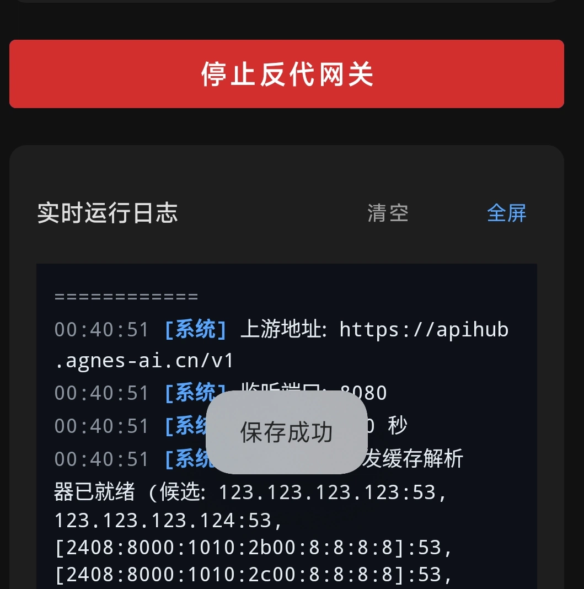
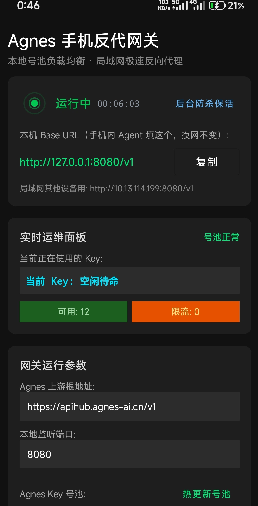
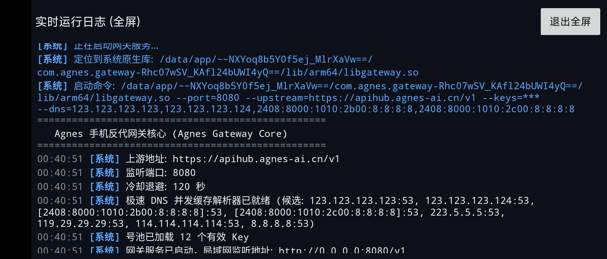

# Agnes 手机反代网关

把闲置 Android 手机变成一个 OpenAI 兼容的本地反代网关：号池轮询、403 自动剔除、流式透传、前台保活。

  
  

## 下载

[最新 Release](https://github.com/Huo-zai-feng-lang-li/agnes-gateway-android/releases/latest)

## 快速开始

1. 安装 APK，填入 Agnes Key，启动网关。
2. 客户端 Base URL 填 `http://127.0.0.1:8080/v1`，API Key 随意填。
3. 局域网其他设备用界面显示的 `http://<手机IP>:8080/v1`。

## 说明

- 2.5 / 3.0 Flash 免费；403 视为封禁，自动从号池剔除。
- 改 Key 后点「热更新号池」，无需重启。
- 变更记录见 [CHANGELOG.md](CHANGELOG.md)。

> 仅供个人学习与自用，请遵守上游服务条款。
